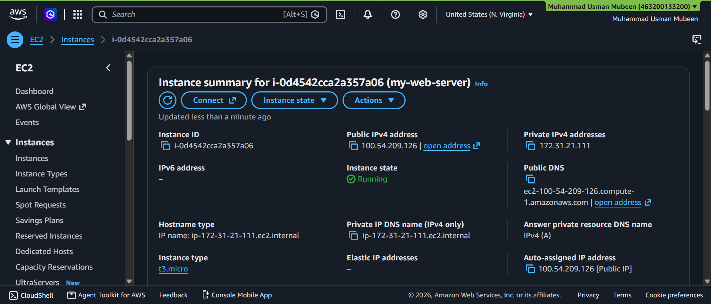
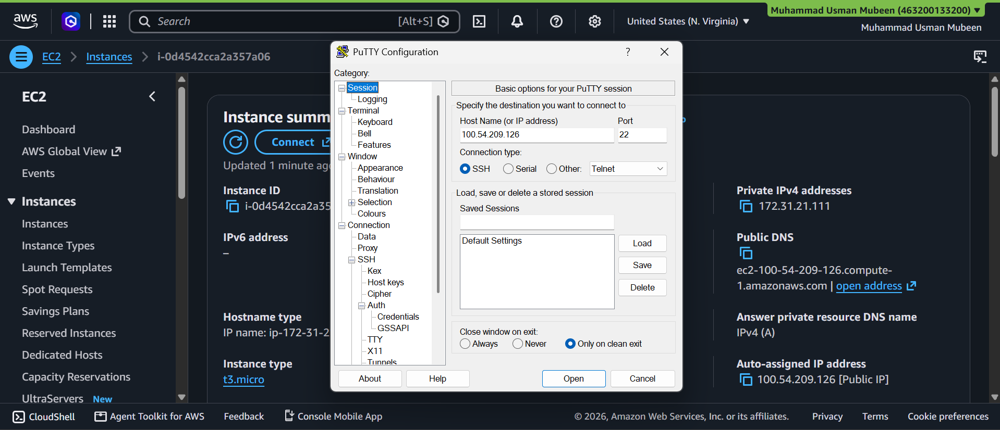
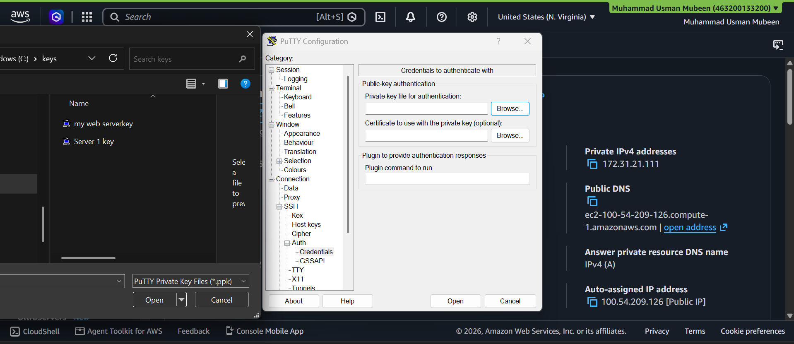
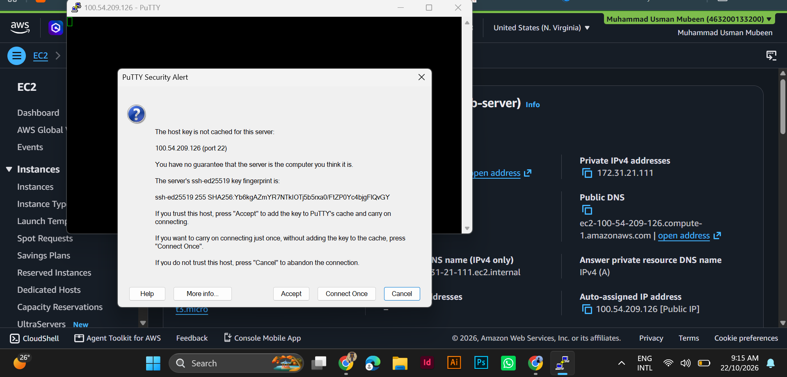
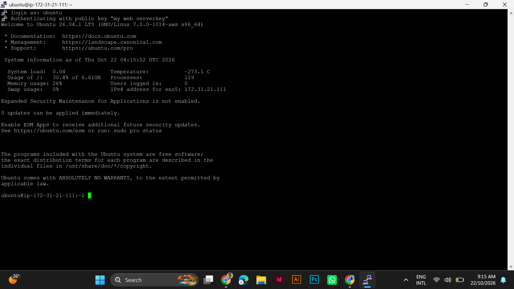
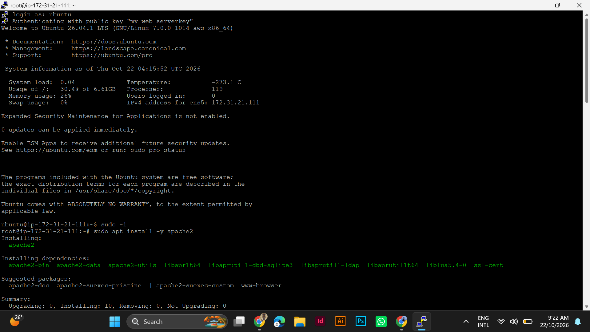
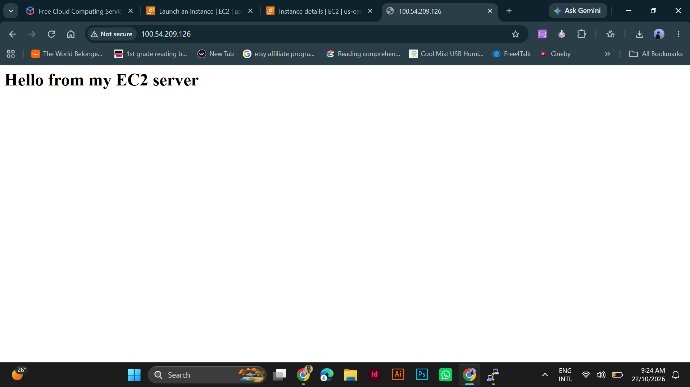

# AWS EC2 Web Server (Ubuntu + Apache)

A hands-on project where I launched an Amazon EC2 instance, connected to it over SSH using PuTTY, installed the Apache web server, and served a web page on the public internet.

## Goal

Learn the basics of running a server in the cloud: launching a virtual machine, securing access with a key pair and security group, connecting remotely, and hosting a simple website.

## Architecture

```
Browser (HTTP :80)  --->  EC2 instance (Ubuntu, Apache2)  <---  PuTTY (SSH :22, key pair .ppk)
                          Region: us-east-1 (N. Virginia)
```

## Services and Tools Used

| Item | Details |
|------|---------|
| Cloud provider | AWS (Free Tier account) |
| Service | Amazon EC2 |
| Region | US East (N. Virginia) `us-east-1` |
| Instance type | `t3.micro` |
| Operating system | Ubuntu 26.04 LTS |
| Web server | Apache2 |
| SSH client | PuTTY on Windows |
| Key format | `.ppk` (PuTTY private key) |

## Steps I Followed

### 1. Launch the EC2 instance
- Opened EC2 > Launch instance and named it `my-web-server`.
- Chose the Ubuntu AMI and the `t3.micro` instance type.
- Created a key pair and downloaded it in `.ppk` format for PuTTY.

### 2. Configure the security group
- SSH (port 22) allowed from **my IP only**.
- HTTP (port 80) allowed from the internet so the page can be viewed.

### 3. Connect with PuTTY
- Entered the instance's public IPv4 address as the host name, port 22.
- Under Connection > SSH > Auth > Credentials, selected my `.ppk` private key.
- Accepted the host key on first connection and logged in as `ubuntu`.

### 4. Install Apache and create the web page
```bash
sudo -i
apt update
apt install -y apache2
echo "<h1>Hello from my EC2 server</h1>" | tee /var/www/html/index.html
```

### 5. Test in the browser
- Opened `http://<public-ip>` in the browser.
- The page "Hello from my EC2 server" loaded successfully.

## Screenshots

| Step | Screenshot |
|------|------------|
| Instance running in the EC2 console |  |
| PuTTY session settings (host and port) |  |
| Selecting the `.ppk` private key |  |
| PuTTY security alert (host key) |  |
| Logged in to Ubuntu over SSH |  |
| Installing Apache2 |  |
| Web page live in the browser |  |

## What I Learned

- How to launch and manage an EC2 instance.
- How key pairs work for SSH authentication, and how to use a `.ppk` key with PuTTY.
- How security groups act as a virtual firewall (SSH restricted to my IP, HTTP open).
- Basic Linux server administration: installing packages and editing web content.
- Why unused resources should be terminated to avoid unexpected charges.

## Cleanup

After taking the screenshots, I terminated the instance (EC2 > Instance state > Terminate) so no further charges apply.

## Next Projects

- Host a static website on Amazon S3.
- Build a VPC with public and private subnets, an RDS database, and CloudWatch monitoring.
